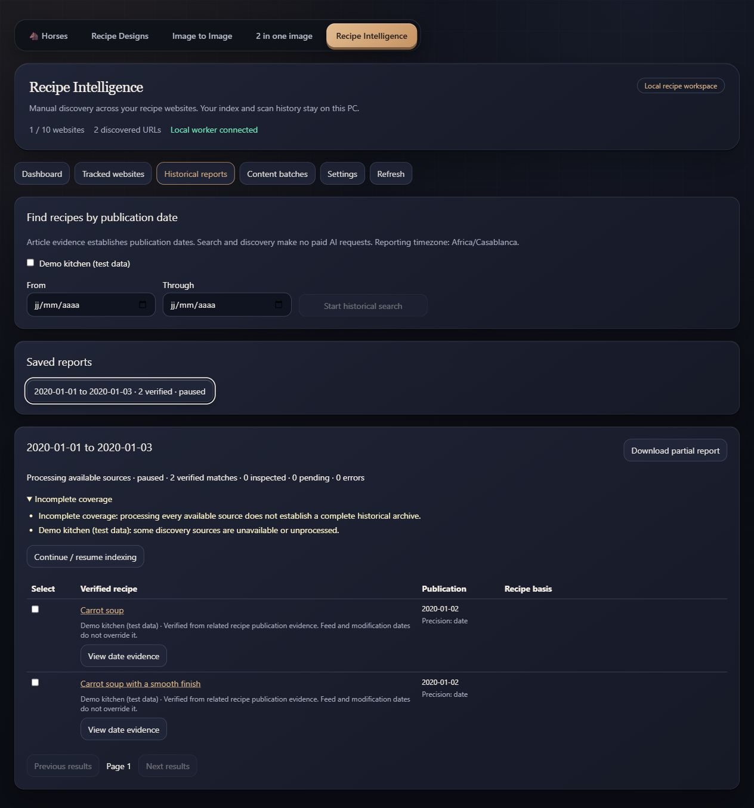

# Recipe Intelligence verification

Implementation covers the five approved phases. Verified on Windows on 10 November 2026 with Node.js 24.15.0, Next.js 15.5.29, better-sqlite3 13.0.3, and SQLite 3.53.4. Automated tests use mocked AI responses. The user separately approved two production batches: the original article with three images and a later article-only test of the new blog template.

## Completed functionality

| Phase | Delivered |
| --- | --- |
| 1 | Windows setup/launcher/Stop controls, selected local storage, SQLite migrations and backups, single-worker lease, website controls, RSS/Atom/nested/compressed sitemap discovery, durable scan checkpoints and history, local/hosted separation |
| 2 | Publication evidence and canonical aliases, date precision and Casablanca reporting, progressive historical searches, advertised WordPress filters, feed priorities, partial reports, coverage notes, pagination, pause/resume and failed-page retries |
| 3 | Original-recipe snapshots, versioned embedded Humanizer prompt, structured article/SEO/recipe-card output, advisory checks and one optional correction, cost approval and spending ledger, immediate article saving |
| 4 | Optional alternative-source research, explicit alternative URLs, evidence-based automatic selection, per-recipe ambiguity review, all three automation modes, immutable batch settings |
| 5 | Image 2.6 Sunburst and Flare, quality/complexity controls, free live metadata/documentation checks, model-specific estimates, exact-size Sharp exports, local Pinterest title, provider receipts, per-image retries, versioned artifacts and checksums, uncertain-charge reconciliation |

Existing navigation, recipe/design tools, image models and controls, and browser-local histories were retained. The existing hosted deployment configuration remains usable; nothing was deployed or published during this work.

## Checks

| Check | Result |
| --- | --- |
| `npm test` | 174 passed, zero failed: original 98 tests plus 76 Recipe Intelligence tests |
| `npx tsc --noEmit --incremental false` | Passed |
| `npm run build` | Passed, including existing APIs and the local namespace |
| Local production build | Passed through the Windows launcher |
| `node scripts/recipe-intelligence-smoke.cjs` | Passed |
| Production browser UI | Reports, evidence/coverage layout, saved content, sandboxed article preview, Flare selection and complexity persistence checked; zero browser console errors observed |
| Free OpenAI model check | GPT-5.4 Mini, Image 2.6 Sunburst, and Image 2.6 Flare listed for the configured account; live documentation/pricing checks passed |
| Paid generation | Original approved batch: article and three Sunburst photographs, $0.14198315. Article-only blog test: $0.01890345. New $0.20 full-test batch: article, one correction and three medium Sunburst photographs, $0.1275353. All completed with zero outstanding reservation. |

The Windows smoke test starts the actual Next.js server and worker in an isolated folder with spaces. It verifies setup, Basic Auth preservation, launcher session/CSRF checks, duplicate-launch reuse, backups, stopping only owned children, restart recovery, stable-port reuse, saved report pause state, content defaults, and zero paid calls with a key configured. Test source URLs use `.invalid` and cannot trigger a real crawl.

The folder chooser's Windows Documents suggestion, editable path, Browse control, and Save and start interaction were verified during Phase 1. Its implementation remains unchanged. The final UI check used isolated, clearly labelled demo data and mocked article output. The test application was stopped after verification.

## Regression coverage

- Discovery: 3,000 baseline URLs without publication assignment; feed/sitemap duplicates; nested/compressed sources; pagination loops; invalid XML, entities and parser limits; retry backoff; robots and source failures; independent websites; ten-site limits; archive/restore; interrupted jobs; backups; path traversal and unsafe network destinations.
- Historical reports: old publications with new modification/feed dates; missing/invalid/conflicting dates; earlier contradictory feed evidence; date-only precision; Casablanca normal and Ramadan boundaries; related/unrelated JSON-LD; immediate cached matches; partial progress; pause/resume; source failures; advertised WordPress date filters and looping pages; canonical aliases; bounded result pages and complete partial exports.
- Content: no calls before cost approval; captured settings; original facts and Humanizer prompt; all review modes; clear versus ambiguous source selection; numerical/unit/method preservation; unsupported tips; one correction limit; article saves before images; 1200 × 1500 and 1000 × 1500 outputs; optional local title.
- Spending/recovery: insufficient budget, unknown charges and missing usage, continuing unaffected recipes, no automatic uncertain retry, recovery from a saved response after interruption, image-only retry, explicit versioned regeneration, article regeneration that reuses images, checksum detection, local file repair, and additive Phase 1 database migration with a pre-upgrade backup.
- Interfaces: exact local origin/session/CSRF enforcement, no hosted database access, sandboxed artifact previews, report and batch APIs, per-recipe UI selection, visible quotes before approval, and existing navigation/draft preservation.

## Recipe-blogger template update

New batches default to the supplied 1,000–1,200-word WordPress brief, with eleven requested sections and automatic recipe-variable mapping. The compact style remains available, and existing batches keep their original style. The prompt retains Humanizer and factual-preservation instructions. Source-supported optional sections use internal evidence references. Word count is advisory, with at most one approved correction.

Ten additional regression checks cover the versioned prompt and strict output schema, bounded source guidance extraction, all eleven rendered sections, factual and anecdote checks, approximate-time display without fabricated JSON-LD precision, an approved mocked blog run, the single-correction limit, legacy batch compatibility, optional-guidance refresh, and rich-text clipboard output without paid calls. The clipboard test verifies bold headings and numbered lists, separate plain text, and exclusion of the JSON-LD script. The schema follows the official [Structured Outputs guide](https://developers.openai.com/api/docs/guides/structured-outputs).

New saves include `article.txt`, and the UI shows a word count and **Copy for WordPress**. The user's original completed article and images are preserved. Automated tests verify application behavior with mocked responses; the separately approved live blog test below records the actual model result.

The saved Newsile cinnamon-roll page was also inspected with the new extractor: it retains 16 ingredient entries, 10 cooking steps, and 16 relevant supporting passages. A related breakfast-burrito card is excluded. Regression coverage also excludes linked post headings, nested articles, sidebars, hidden material, and comments from supporting recipe evidence.

A fresh 12 October–10 November search exposed common section labels that the conservative HTML fallback did not recognize. It now accepts explicit labels such as “What you will need,” “How I make it,” and “How to make them,” while still rejecting ambiguous headings and recipe collections. A regression test covers the accepted variants and misleading near matches. The rebuilt local application verified five additional recent recipes, including Tortilla Soup with 18 ingredient entries, seven steps, explicit prep/cook/total times, and an article-supported publication date. The report was paused after finding a suitable new recipe; it remains a partial historical search.

The user then supplied a RecipesHub24 casserole URL. A fresh site discovery and date-filtered WordPress API search verified the requested recipe among four initial matches. Its recipe card splits the leading cooking verbs between `HowToStep.name` and `text`; extraction now preserves both fields, avoids duplicate complete step names, and collapses equivalent `8` / `8 servings` yield representations. Repeated identical WordPress H1 titles no longer hide optional article guidance; distinct titles remain ambiguous. Three regression tests cover these cases. The live extraction retained 11 ingredient entries, seven complete steps, eight servings, and 19 supporting passages. Tests, TypeScript checks, hosted production build, and local production rebuild passed. The original completed batch remains intact; generation of a new batch requires its own cost approval.

For the casserole test, the user explicitly approved a $0.11 article-only budget. GPT-5.4 Mini returned a 936-word draft and a 947-word correction. The application saved that 947-word article with a length warning after its single correction, as designed; the live run did not meet the requested 1,000–1,200-word range. It completed all eleven sections, saved the recipe facts and HTML/Markdown/plain-text outputs, skipped all image stages, and reported $0.01890345 for two calls with no uncertain charge. A separate editorial review in chat produced a 1,163-word HTML export using the same source evidence without another API request. The original generated batch remains unchanged for comparison. The reviewed export is an editorial artifact, not evidence that the automatic generation met the word target. Structural checks verified eleven H2 sections, four FAQs, seven cooking steps, and unchanged recipe-card quantities/times. Automated browser preview of the local export was blocked by the browser's file-URL policy; no alternate browser or server workaround was used.

## Full casserole test with a $0.20 budget

The user explicitly authorized a new article and all three photographs with a $0.20 limit. A new original-source batch used GPT-5.4 Mini, Sunburst at medium quality, 1024 × 1536 native size and default complexity. The free account/documentation checks passed; its source-aware estimate was $0.150307. Five production calls completed for $0.1275353: article $0.01084575, correction $0.00895455, featured $0.03588, alternate $0.035905, Pinterest $0.03595. No charge was uncertain and no reservation remained. Earlier batches were preserved.

The saved HTML now embeds each successful JPEG as it becomes available. HTML repair, later images and article replacement reuse saved prose and photographs without repeating paid calls. Regression assertions cover all three embedded byte sequences, relative Markdown images, draft Recipe image entries, unchanged word count and local repair without new provider calls. Another test verifies that estimates scale with known source size while unknown research retains a conservative allowance. The complete 174-test suite, TypeScript, hosted production build and launcher-managed local build passed. The current launcher fingerprint matched the implementation.

The revised length prompt still produced a 975-word final automatic draft, so the application retained its advisory length warning after one correction. A separate free editorial revision produced 1,129 words by expanding useful preparation notes and FAQs, rewriting cooking prose and clarifying timing. The reviewed HTML and package retain the same recipe quantities and three generated photographs; the original 975-word application output remains unchanged. The review is recorded in the export's `editorial-review.json`. Both versions contain eleven H2 sections. Structural checks decoded all three embedded JPEGs and verified 1200 × 1500 featured/alternate and 1000 × 1500 Pinterest dimensions. Individual photographs were visually inspected; browser rendering of the local HTML was not repeated after the earlier file-URL policy block.

## Live model documentation

The implementation checked the official [Sunburst model page](https://developers.openai.com/api/docs/models/gpt-image-2.6-sunburst), [Flare model page](https://developers.openai.com/api/docs/models/gpt-image-2.6-flare), and [image-generation guide and calculator](https://developers.openai.com/api/docs/guides/image-generation#calculating-costs). The 2.6 formula includes its own low/medium multipliers; older output-token tables are not used for those models. The writing profile uses [GPT-5.4 Mini pricing](https://developers.openai.com/api/docs/models/gpt-5.4-mini).

The initial live check used only public documentation and authenticated GET model metadata. Account listing is evidence of model visibility, not proof that a particular image request will succeed. The subsequent user-approved production batch confirmed Sunburst generation and retained all three photographs. No disposable paid probe was sent. Flare generation has not been tested with a paid request. Costs are calculated from returned usage; missing or uncertain usage stays reserved for reconciliation. Provider-side image usage has no exact dollar cap, so estimates and reservations cannot guarantee a fixed per-image bill.

## Source-specific limits

Verification accepts relevant Recipe JSON-LD or one article with clearly labelled ingredient and cooking-method lists. The HTML fallback preserves groups and numerical facts and uses separate Article/metadata evidence for the publication date. It rejects ambiguous collections and nested recipe lists. Approximate optional durations can retain their source wording in a blog article but remain absent from exact JSON-LD fields; conflicting duration labels are omitted. JavaScript-only or image-only recipe cards, missing essential facts, and inaccessible alternatives can require another source. The public WordPress path is used only when advertised; unsupported filters fall back to indexed article inspection. A previous unpaid BBC Good Food probe returned an HTML/challenge response at robots validation, so it was recorded as restricted and not bypassed.

A follow-up live Newsile test exposed a connection bug: the first DNS answer used an unreachable IPv6 route even though IPv4 worked. Requests now retain all validated public addresses and use [Node's address-family fallback](https://nodejs.org/api/net.html#socketconnectoptions-connectlistener), while still rejecting any private DNS answer and pinning the validated results. The updated fetcher retrieved the site's robots file successfully. Regression tests cover both address families, mixed unsafe DNS, HTML recipe/date extraction, ambiguous sections, optional-duration conflicts, and source notes that do not trigger paid corrections. After a successful local production rebuild, the existing 1–9 November report verified the cinnamon-roll article published on 7 November, retaining 16 ingredient entries and 10 cooking steps while deeper indexing continued. Saved history was preserved, and no paid AI processing was started.

Successful processing means available work was processed. It does not prove every historical publication was found. These coverage limits remain visible in reports. No schedules or publishing were added.

## Launch

### WordPress website connections

The [WordPress export integration](wordpress-export.md) adds independent connections for multiple WordPress sites, encrypted local credentials and an explicit destination selector. It uploads only saved edited images to the chosen site's Media Library and copies the article with hosted URLs. Receipts and a per-site checksum ledger preserve successful uploads. Unknown outcomes reconcile without automatically repeating a POST; individual failures do not stop other images. Publishing remains manual.

Verification passed: 221 tests, TypeScript, hosted and local production builds, and the isolated Windows launcher smoke test. The new Settings screen was verified in the browser. The schema-5 migration saved a backup and preserved all eight batches, eight content items, 101 stages, 55 API calls and 121 artifacts, including every artifact file checksum. The source-photo and import tables also matched the pre-change snapshot. No paid AI request or real WordPress upload ran during verification. Live authenticated upload awaits the owner's private connection in Settings.

### Interface simplification verification

The interface audit found repeated Dashboard/website navigation, a wall of generation controls, duplicate image downloads, and article actions below the entire gallery. Current-session before screenshots are saved under `docs/ui-simplification/01-before-home.png` through `04-before-downloads.png`.

The simplified navigation is Tracked websites, Find recipes, My articles, Use a recipe URL, and Settings. Infrequent website actions, older scans, generation controls, repair actions, machine-readable downloads and billing details use closed disclosures. Active failures, required reviews and initial cost approval remain visible. Completed results put preview, WordPress copy, article download and ZIP first; edited photos are shown by default and originals require the comparison toggle. Historical coverage remains explicitly marked incomplete. No automatic scans, model substitutions, prompt changes, schema migrations or paid work were added.

Verification passed: 205 tests; TypeScript; hosted and local production builds; isolated Windows launcher smoke test, including duplicate-worker prevention, persistence and controlled shutdown. Browser checks covered navigation, report date shortcuts, saved reports and recipes, edited/original comparison, sandboxed article preview and Escape dismissal. A 390-pixel viewport kept the Settings and results within the page width; report tables scroll inside their container. The viewport was restored after testing. After screenshots are saved as `05-after-websites.png`, `06-after-results.png`, `07-after-gallery.png`, `08-after-settings.png` and `09-after-mobile.png` in the same directory.

The local application and worker were restarted successfully. Twelve data tables and all 103 saved artifact file hashes matched the pre-change snapshot. All seven existing batches were retained. The API ledger remained at 48 entries: no new paid requests occurred during implementation or verification.

Double-click **Start Recipe Intelligence.cmd** and choose a local storage folder. Follow the [setup and recovery guide](recipe-intelligence.md). Use **Stop Recipe Intelligence.cmd** when finished.

## Manual research choices and WordPress scheduling — 2026-11-12

Research now pauses for an explicit Keep current recipe / Replace current recipe choice. Suggestions retain Visit recipe links, and incomplete candidates cannot replace the selected recipe. Replacement invalidates the frozen writing request for article-only jobs too, prepares the new source and photographs, and requires renewed cost approval.

The article library supports single and bulk publication, with a separate Draft / Publish now / Schedule action and reporting-timezone date/time for each article. WordPress Bridge 1.2.0 stores native future posts and cron events. Existing drafts and schedules reuse their post IDs. Lost update responses no longer reconcile against a stale earlier draft receipt.

Validation: 120 targeted Node tests passed across research, reference workflows, connection recovery, library actions, WordPress media/publication, scheduling and React interaction tests (initial timezone expectations were corrected to respect the installed timezone database). Both TypeScript checks and the launcher-managed production build passed. A disposable local WordPress + WP Recipe Maker installation passed 85 integration assertions, including draft-to-future dates, rescheduling, early/due cron behavior, native recipe-card scheduling, Site Token permissions and duplicate protection. No real WordPress destination or paid provider was used. Chrome automation was unavailable; rendered interactions were tested with React/JSDOM, and the live local snapshot/library APIs returned HTTP 200.

The local E: workspace was backed up before restart; SQLite integrity and foreign-key checks passed. The app restarted in normal mode with its worker online. The live paid-call ledger stayed at 48 succeeded and 3 uncertain calls; no new WordPress exports were created. Existing uncertain charges were preserved. Bridge 1.2 must be installed on destination websites before scheduling is available; punctual execution depends on their WordPress/hosting cron.

## Adaptive article writing — 2026-11-12

Master profile v5 preserves the user's V4 master and privacy addendum, adding a paid, receipt-backed editorial brief before new articles. The brief reads bounded source prose and recent completed openings, chooses a dish-specific angle and optional section order, and stays private. Existing frozen jobs retain their requests. Estimates include analysis, writing and the optional correction. Browser captures use saved text rather than retrying the blocked source URL.

Validation passed across content/reference workflow regressions, 17 editorial/master tests and 30 blog/UI tests, plus worker TypeScript, local TypeScript and the launcher-managed production build. Targeted checks cover approval-before-payment, history-aware planning, article-only output, immutable old requests, uncertain-call protection, local receipt reuse, and private plans. Live inspection also exposed and fixed an existing validator bug that mistook the “g” in “e.g.” for grams and restored source narration. Supporting-evidence extraction now handles a unique title outside the article body. FAQ question duplication and inappropriate reheating headings on cold desserts were corrected.

The owner authorized three API trials. Three recipes were tested in two iterations using the saved GPT-5.4 Mini setting, with zero image-generation requests and no WordPress publication. All 16 new text requests succeeded. Total measured API cost across both rounds: **$0.12241965**, below the communicated $0.49 overall ceiling. Final output was manually reviewed; an incorrect FAQ yes/no answer, an overlong meta description, and unsupported dessert handling advice were corrected/removed locally. The original responses, pre-review file versions and per-article review records remain available. These manual edits are documented rather than presented as untouched model output.

Final articles are completed and available in the local library; preliminary drafts are archived. A Desktop comparison page contains the three reviewed articles, private approach summaries, downloads and review notes. Actual app screenshots and the comparison were checked in headless Chromium; all three tabs work, the 390px layout has no horizontal overflow, and there were no page errors. SQLite integrity is OK, foreign-key checks are clear, the worker is online in normal mode, and the three pre-existing uncertain charges remain untouched. The ledger now contains 64 succeeded and 3 uncertain calls, with zero WordPress exports.
