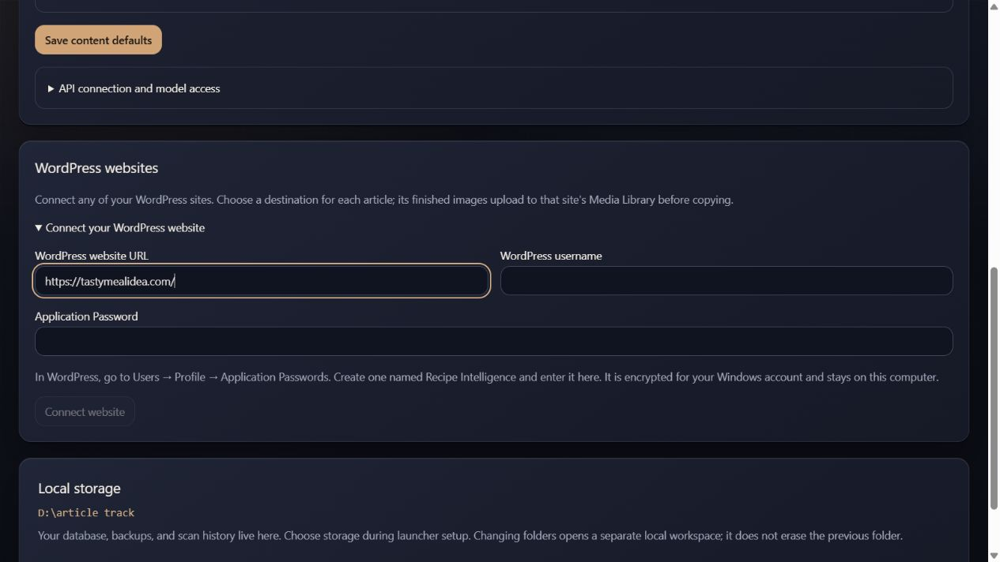

# WordPress publishing and recipe cards

Recipe Intelligence can connect to multiple WordPress websites. Each connection is independent of tracked discovery websites, and there is no hard-coded destination. It uses the site's standard WordPress REST API and an Application Password. The optional Recipe Intelligence Bridge adds direct draft/live posting and a per-site default recipe card.

## Install the bridge and choose a recipe card

1. In the app, open **Settings → WordPress websites → Download WordPress plugin**.
2. In WordPress, use **Plugins → Add New → Upload Plugin**, upload the ZIP and activate it.
3. Open **Settings → Recipe Intelligence** in WordPress. Choose **WP Recipe Maker** (must be active) or the **Recipe Intelligence card**, then save.
4. Connect the site below, or click **Sync website settings** on an existing connection. The app displays the selected card.

Tasty Recipes and Create by Mediavine are recognized but disabled in the selector until their adapters are supported. The connector never silently switches card plugins. Requires WordPress 6.2+ and PHP 8.0+; WP Recipe Maker has its own minimum requirements. Native integration was exercised with WP Recipe Maker 10.9.2.

## Send a draft or publish live

Choose a destination beside a saved article, then **Prepare WordPress post**. Preparation reads the site's current card setting and uploads only finished article images to that site's Media Library. Review the destination, recipe card and image count, then choose **Save draft**, or check the explicit public-publishing choice and click **Publish live**. Publishing also requires the WordPress user's `publish_posts` permission.

The first image in the finished article automatically becomes the WordPress featured image, for both drafts and live posts. It stays in the article too, and WP Recipe Maker uses the same uploaded image for its card. Selection follows article order, not the filename or upload order. No extra image generation or duplicate upload is needed.

The app builds the card from the saved `recipe.json`, using the same supported facts as the article. This requires no additional AI request and does not rewrite the article. WP Recipe Maker receives an editable native recipe record and Gutenberg recipe block; its own template and structured-data system render that card. Complete ingredient lines are retained without guessing a quantity/unit split, so adjustable servings are not inferred. The built-in card renders a shortcode and Recipe structured data. The bridge does not emit duplicate Recipe data for native cards.

Every export snapshots the card setting, recipe data, content and destination. Changing the source article or website settings requires another review. Sending an unchanged draft again returns the existing post, and **Publish live** can publish that same draft. Already-exported content is not overwritten when the local article changes; use **Open in WordPress** to edit the existing post. Interrupted sends retain receipts and use read-only reconciliation via **Check saved post**, without blindly resending or creating duplicates.

Draft/live state is selected in the app for each send; there is no scheduled publishing. New posts belong to the connected WordPress user and use the site's default category. Original reference photos remain local references and are never used as exported article images.

## Connect a website

1. Open **Settings → WordPress websites** in the local application.
2. In that website's WordPress dashboard, open **Users → Profile → Application Passwords**, name a new password **Recipe Intelligence**, and generate it.
3. Enter the website's HTTPS address, WordPress username and Application Password in the local form. Click **Connect website**.
4. Use **Connect another website or update credentials** to add another destination or replace a revoked password.

The password is encrypted using Windows DPAPI for the current Windows account. It is never returned by the local API or stored in browser storage. Moving the database to another Windows account requires reconnecting. Disconnect removes the local credential; revoke the Application Password in WordPress if it should no longer be usable.

## Copy an article with hosted images

1. Open the recipe under **My articles**.
2. Choose the **WordPress destination**. With multiple connections, choose a website explicitly.
3. Click **Upload images and copy**. Each finished, edited JPEG used by the saved article uploads to that destination's Media Library. Original reference photographs are excluded.
4. Paste into the WordPress visual editor. The copied HTML contains the uploaded image URLs and media IDs. Select a featured image in WordPress as usual.

Uploads reuse existing finished images; there are no AI generation calls. This copy workflow remains available without the bridge. Direct draft/live sending uses the bridge workflow above. The original local HTML, saved articles, images and paid-stage records are preserved.

If the browser blocks clipboard access after a long upload, click **Copy uploaded article**, or use **Download WordPress HTML**. Both reuse the completed uploads.

## Recovery and limits

- A separate ledger records the target website, image checksum, media ID, HTTPS URL and upload receipt. Copying the same image to the same website reuses its saved upload across restarts. A different website gets its own upload.
- Failed images do not prevent the other images from uploading. Copying resumes failed work and reuses successes. The complete formatted article is offered only when all images in that saved article have hosted URLs.
- A timeout or ambiguous server response retains an uncertain state. Clicking again reconciles the receipt or searches WordPress for the stable image slug; it does not blindly repeat the upload. If no match is available, check the destination's Media Library before further repair.
- The saved article version is checked while exporting. If it changes during upload, click again to use the latest version without repeating completed uploads.
- Only public HTTPS sites are accepted. DNS is checked and pinned; redirects are not followed with credentials or uploads. Response sizes, local paths, file checksums, image types and pixel dimensions are bounded.
- Standard WordPress REST routes must be enabled, and the account must have `upload_files` capability. A security plugin that blocks API access may require configuration on that website. Other CMS platforms require separate adapters.
- Schema version 5 added `wordpress_media`; version 6 adds a separate `wordpress_exports` ledger. Existing databases are backed up with SQLite's backup API before migration.

Official references: [Media REST API](https://developer.wordpress.org/rest-api/reference/media/), [Application Passwords](https://developer.wordpress.org/advanced-administration/security/application-passwords/).

## Bridge verification on 11 November 2026

All 294 application tests pass. Dedicated checks cover site-default sync, factual card payloads, draft-to-live promotion, stale review rejection, uncertain-send reconciliation, receipt repair, migration backups, private credential handling, native-card replacement, preserved step numbering and the explicit publish control. TypeScript, the hosted production build, the local build and isolated Windows launcher checks pass.

The PHP integration test runs against a disposable local WordPress 7.1.4 installation with WP Recipe Maker 10.9.2. It verifies actual native recipe creation, ingredient quantities, cooking time, parent association, the Gutenberg recipe block, draft and live status, idempotent sends and denial of anonymous/private access. No customer website is modified and no paid provider is called. Run `scripts/test-wordpress-bridge.php` with a disposable WordPress directory under `.test-build/wp-integration`; that directory needs the official SQLite Database Integration and WP Recipe Maker plugins. The executable integration test is separate from the Node test suite.

The bridge uses WordPress Application Password authentication and capability checks, rather than a separate unrestricted site secret. The reference project's Article Bridge informed the draft/media flow; native WP Recipe Maker mapping follows its [official REST API documentation](https://help.bootstrapped.ventures/wp-recipe-maker/for-developers/wordpress-rest-api/) and plugin source. Other recipe-card adapters need their own verified implementation before they can be enabled.

## Original media-export verification on 11 November 2026

All 221 tests passed, including sixteen dedicated WordPress backend and interface tests. TypeScript, hosted and local production builds, and the isolated Windows launcher smoke test passed. The smoke test verified saved imports, duplicate-worker prevention, controlled shutdown, schema version 5 and zero paid provider calls. Tests cover separate destinations, generated-image bytes, authenticated request boundaries, Windows encryption, clipboard fallback, retries and receipt recovery.

The local application was restarted and its new Settings form checked in the browser. All eight existing batches, eight content items, 101 stages, 55 API ledger entries, thirteen reference photos, ten content photos and 121 saved artifacts were unchanged. All 121 artifact file checksums matched. The database has a pre-migration backup, and no WordPress media uploads or paid AI requests occurred during verification.

The public API at `tastymealidea.com` advertises the standard media route and Application Password support. The URL is saved as a suggested first connection only. Authenticated upload on that live site remains unverified until the owner enters a private Application Password in the application and requests an upload.

